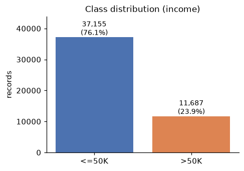
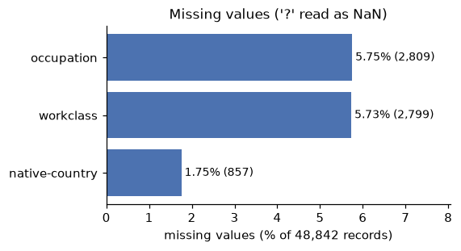
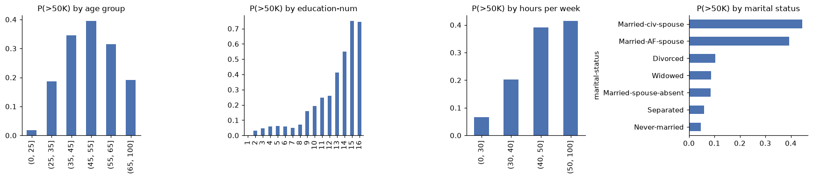
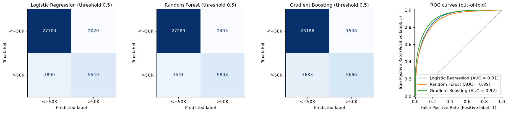
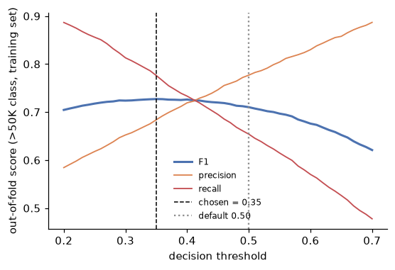
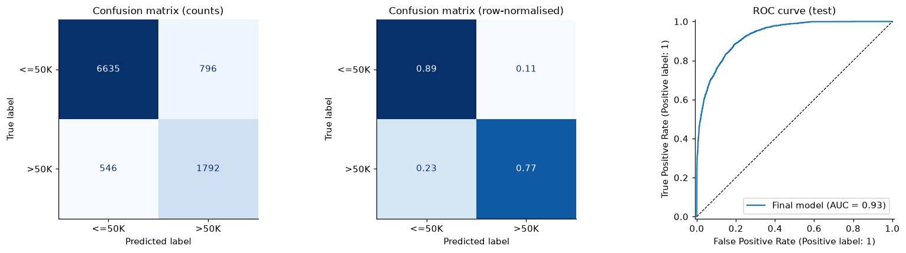
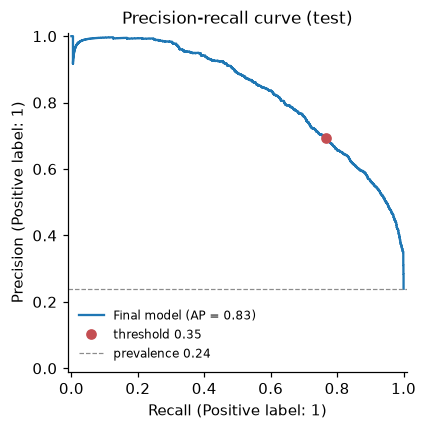
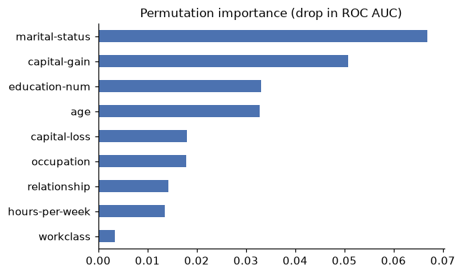
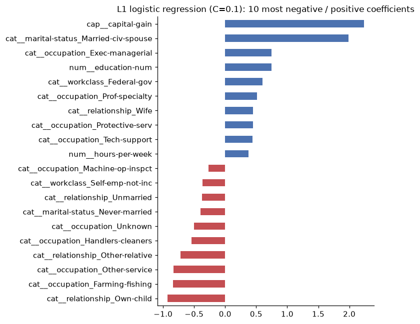
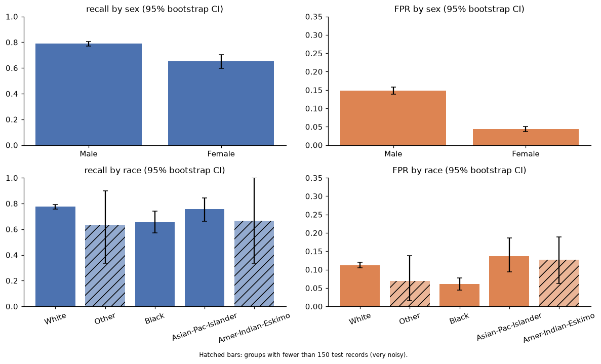

# Census Income Classification (UCI Adult)

Predict whether a person's annual income in the 1994 US census exceeds $50K, using a leakage-safe
scikit-learn pipeline, a documented model comparison, a held-out test evaluation and a fairness
inspection.

> **Educational project.** The data are from 1994 and the $50K threshold is not meaningful today. The
> model must not be used for credit, hiring, benefits or any other decision about real people
> (see [Fairness and limitations](#fairness-and-limitations)).

## Overview

| | |
|---|---|
| Task | Binary classification: income `>50K` vs `<=50K` |
| Data | UCI Adult, `adult.data` + `adult.test` pooled: 48,842 records, 23.9% positive |
| Split | One stratified 80/20 split (`random_state=42`): 39,073 train / 9,769 test |
| Final model | Gradient boosting (`max_depth=5`, 150 trees) behind an L1 logistic-regression feature selector, decision threshold 0.35 |
| Headline result | Test F1 (>50K) **0.728**, ROC AUC **0.930** |

This is a personal portfolio project. It was reviewed for data leakage and
reproducibility: the original numbers were re-run and confirmed, the code was moved into an importable
package, tests and uncertainty estimates were added, and the claims in the write-up were checked
against the output. See [`reports/audit_report.md`](reports/audit_report.md).

## Dataset

Source: Becker, B. and Kohavi, R. (1996). *Adult*. UCI Machine Learning Repository,
<https://archive.ics.uci.edu/dataset/2/adult>. The data are **not** included in this repository; see
[`data/README.md`](data/README.md) for where to put `adult.data` and `adult.test` (`data/raw/`).

Characteristics (computed by the code):

- 48,842 records, 14 feature columns; missing values (`?`) in `workclass` (2,799), `occupation` (2,809)
  and `native-country` (857).
- 37,155 people earn `<=50K` and 11,687 earn `>50K` (23.9%), so accuracy alone is misleading: always
  answering `<=50K` gives 0.761 accuracy and finds no high earner.
- 52 exact duplicate rows and 5 groups of identical features with conflicting labels. They are kept
  (nothing is removed automatically); 18 test rows are exact copies of training rows and excluding them
  does not change the test F1.
- The official train/test files come from a random split, so pooling them and making a new stratified
  split is valid. Results are therefore not directly comparable with papers that use the official
  split; the repo reports that variant too (below).

## Workflow

1. Load and validate the two files (`census_income.data`).
2. One stratified split; the test set is untouched until step 8.
3. Preprocessing inside a `Pipeline` / `ColumnTransformer`, fitted on training folds only: median
   imputation + (scaling for logistic regression) for numeric columns; constant `"Unknown"` imputation +
   one-hot encoding for categorical columns (missingness is informative).
4. Compare a majority-class baseline, logistic regression, random forest and gradient boosting with
   5-fold stratified CV (metrics for the `>50K` class).
5. Tune each model with its own small grid (scored on F1, same folds).
6. L1-regularised logistic regression as feature selection; check it in front of gradient boosting and
   check how stable the selected columns are.
7. Choose the decision threshold (0.35) on out-of-fold training predictions.
8. Evaluate once on the test set; bootstrap 95% intervals; error analysis; permutation importance.
9. Fairness inspection by sex and race (not model inputs) with bootstrap intervals, plus an ablation of
   proxy features.

Choices that were tested rather than assumed: dropping `native-country` (F1 0.656 vs 0.657 with it,
half the columns), keeping capital gain/loss raw (a `log1p` transform lowered F1, 0.645 vs 0.657),
dropping `fnlwgt` (survey weight), `education` (duplicates `education-num`), `race` and `sex`.

## Results

All numbers below come from `results/results.json`, written by `scripts/run_pipeline.py`
(Python 3.14.7, scikit-learn 1.9.1).

**5-fold CV on the training set (mean over folds, `>50K` class)**

| Model | F1 (defaults) | F1 (tuned) | ROC AUC (tuned) |
|---|---|---|---|
| Majority-class baseline | 0.000 | - | 0.500 |
| Logistic regression | 0.656 | 0.656 | 0.905 |
| Random forest | 0.659 | 0.678 | 0.918 |
| Gradient boosting | 0.685 | **0.711** | **0.928** |

Fold standard deviations are about 0.005 to 0.008, so differences of a few thousandths are noise.

**Held-out test set (used once; threshold 0.35; 95% bootstrap intervals over test rows)**

| Metric | Value | 95% CI |
|---|---|---|
| F1 | 0.728 | 0.714 to 0.741 |
| Precision | 0.692 | 0.674 to 0.709 |
| Recall | 0.766 | 0.749 to 0.783 |
| ROC AUC | 0.930 | 0.925 to 0.935 |
| Average precision | 0.831 | 0.817 to 0.844 |
| Accuracy | 0.863 | 0.856 to 0.869 |

Confusion matrix: TN 6,635 · FP 796 · FN 546 · TP 1,792. The intervals describe test-sample noise only.

**Robustness checks** (run in the notebook, section 10)

| Check | Result |
|---|---|
| Test F1 without the 18 test rows that also occur in training | 0.728 (unchanged) |
| Standardised inputs before the L1 selector | same out-of-fold F1 (0.727) |
| `HistGradientBoostingClassifier`, default settings (CV) | out-of-fold F1 0.728, no better |
| Train on official `adult.data`, test on official `adult.test` | F1 0.720, ROC AUC 0.928 |
| Five other random splits | F1 0.732 ± 0.007, ROC AUC 0.929 ± 0.003 |

The last two are split-to-split variation checks: hyper-parameters were tuned on the seed-42
training data, so they are not unbiased estimates.

## Visualisations

| | |
|---|---|
|  |  |
|  |  |
|  |  |
|  |  |
|  |  |

## Fairness and limitations

`sex` and `race` are **not** model inputs (a test checks that changing them never changes a
prediction). That does not make the model neutral:

- Men are flagged as high earners much more often than women (34.3% vs 11.2%); false positive rate
  14.8% vs 4.4% (ratio about 3.4, 95% CI 2.8 to 4.1); recall 0.79 vs 0.65 (gap 0.137, CI 0.086 to 0.191).
- White vs Black recall: 0.774 vs 0.653 (gap 0.122, CI 0.038 to 0.210). Two race groups (69 and 104
  test people) are too small to conclude anything.
- `marital-status` and `relationship` carry the sex signal (Husband/Wife almost identify it). Dropping
  `relationship` costs 0.002 F1 and does not narrow the gap; dropping `marital-status` as well narrows
  the false-positive-rate gap but costs 0.07 F1.
- The numbers show that error rates differ, not why. Part of the difference mirrors real gaps in the
  1994 labels; the causes are interpretation, not a result of this analysis. When base rates differ, the
  common fairness criteria cannot all be satisfied together, so choosing among them is a decision for
  the people who own the use case.

Other limitations: 30-year-old labels and a fixed $50K cutoff; records are a filtered extract
(not a random population sample); no nested cross-validation (the untouched test set is the unbiased
estimate); the L1 selection step does not improve accuracy (F1 0.7102 vs 0.7107 without it) and the
exact selected columns vary between resamples; the model is less interpretable than logistic regression.

## Installation

Python 3.12 or newer (results reproduced on 3.12.3 and 3.14.7).

```bash
python -m venv .venv
source .venv/bin/activate            # Windows: .venv\Scripts\activate
pip install -r requirements-dev.txt  # pinned versions used for the committed results
pip install -e .
```

## Usage

```bash
# 1. put adult.data and adult.test in data/raw/ (see data/README.md)

# 2. run the tests (about 10 s; the dataset is not needed)
pytest

# 3. regenerate results/results.json and reports/figures/*.png (about 13 min on one CPU core)
python scripts/run_pipeline.py

# optional: tiny smoke test on a subsample (not for reporting)
python scripts/run_pipeline.py --fast

# 4. or walk through it step by step
jupyter lab notebooks/census_income_classification.ipynb
```

## Repository structure

```text
├── README.md
├── requirements.txt          # pinned runtime dependencies
├── requirements-dev.txt      # + pytest, jupyter tooling
├── pyproject.toml
├── data/README.md            # how to obtain the data (files are git-ignored)
├── notebooks/census_income_classification.ipynb   # narrative walk-through using the package
├── src/census_income/
│   ├── config.py             # constants and column lists
│   ├── data.py               # loading, validation, split, data-quality report
│   ├── preprocessing.py      # ColumnTransformer
│   ├── modeling.py           # model / pipeline builders and grids
│   ├── evaluation.py         # CV, threshold selection, test metrics, bootstrap CIs
│   ├── fairness.py           # group metrics and bootstrap gaps
│   ├── analysis.py           # stability, ablation, robustness checks
│   └── plots.py
├── scripts/run_pipeline.py   # end-to-end run -> results + figures
├── tests/                    # 21 unit tests
├── results/results.json
└── reports/
    ├── audit_report.md       # findings, severity, evidence
    ├── Census_Income_Classification_Report.pdf  # short written report
    └── figures/
```

## Reproducibility notes

- `random_state=42` everywhere; library versions are pinned and recorded in `results/results.json`.
- The original notebook was re-run in a clean environment built from the original pins and reproduced
  the original results (confusion matrix, precision, recall, F1 identical; ROC AUC equal to six
  decimals). The refactored pipeline reproduces the same test confusion matrix and F1.
- The 21 unit tests also pass with scikit-learn 1.8.0 / pandas 3.0.2 / numpy 2.4.4. The full run (and
  therefore the committed results) was only executed with the pinned versions. Runtime varies by machine.
  `scikit-learn >= 1.8` is required because of the `l1_ratio` argument.

## Future improvements

- Nested cross-validation to remove the mild optimism of reusing folds for several decisions.
- Repeat the analysis on current, representative income data and audit fairness on it.
- Add calibration analysis and per-prediction explanations (e.g. SHAP) before any real use.
- Compare against other boosting libraries only if they show a measurable gain over the current model.

## Disclaimer

Educational project built on a public benchmark dataset. It is not validated for, and must not be used
in, consequential decisions about people.
